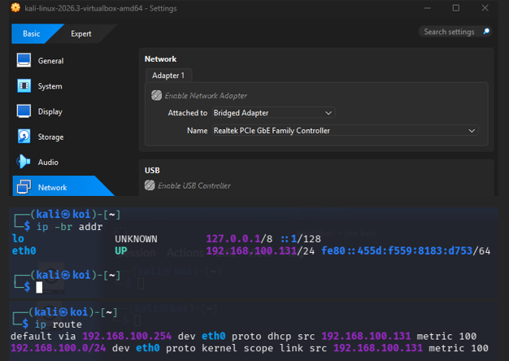
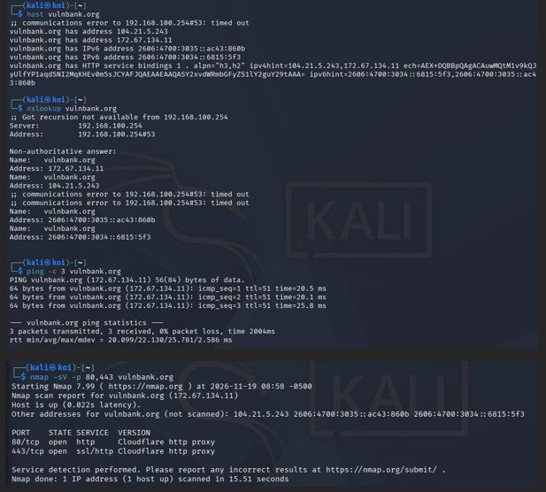
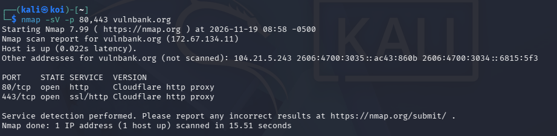
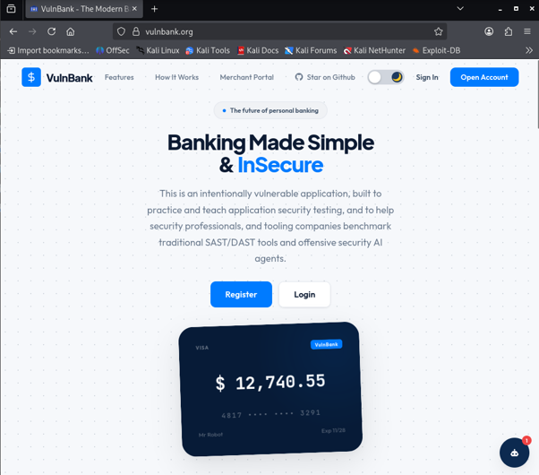
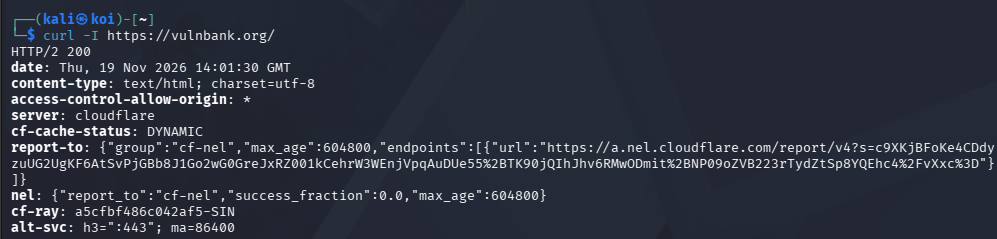
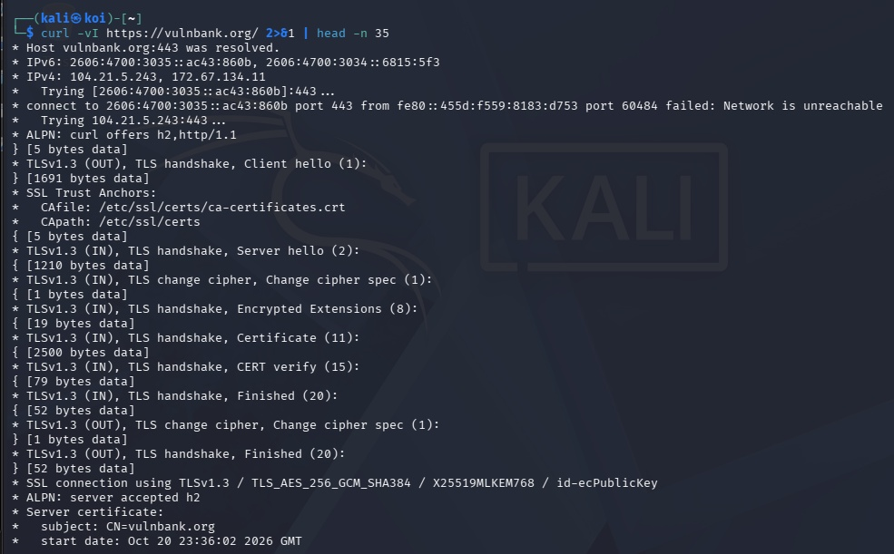
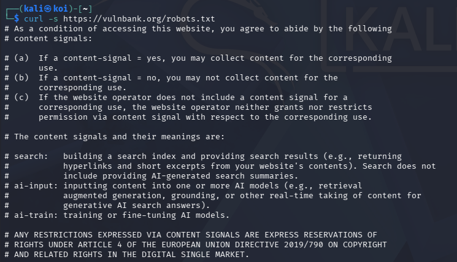

# Lab 4: Active Footprinting Report (`vulnbank.org`)

**Name:** MUHAMMAD QAYYUM BIN MOHD SYAHRIL  
**Student ID:** 52215226074

## Scope & Ethical Boundaries
This lab documents safe, non-intrusive active footprinting against `https://vulnbank.org/`, an intentionally vulnerable training web application. No exploitation, attacks, brute-forcing, credential abuse, or destructive testing were performed.

---

## 1. Own Host Setup (Reconnaissance Machine)
Active footprinting was run from a Kali Linux virtual machine in Oracle VirtualBox.

* **Operating System:** Kali Linux (`kali-linux-2026.3-virtualbox-amd64`)
* **User & Hostname:** `kali@koi`
* **Virtualization:** Oracle VirtualBox
* **Network Adapter:** Bridged Adapter (`Realtek PCIe GbE Family Controller`)
* **Network Interface:** `eth0` (`UP`), IPv4 `192.168.100.131/24` (subnet `192.168.100.0/24`)
* **Default Gateway:** `192.168.100.254` via `eth0`
* **Tools Used:** `ip`, `host`, `nslookup`, `ping`, `nmap`, `curl`, Firefox

### Evidence

---

## 2. Target Setup & Initial Discovery
The reconnaissance target was `https://vulnbank.org/`.

* **Target URL:** `https://vulnbank.org/`
* **Resolved IPv4:** `172.67.134.11` and `104.21.5.243`
* **Resolved IPv6:** `2606:4700:3035::ac43:860b` and `2606:4700:3034::6815:5f3`
* **DNS HTTPS Binding:** Advertised `alpn="h3,h2"`
* **ICMP Reachability:** `ping -c 3 vulnbank.org` returned 3 replies, 0% packet loss (~20.1–25.8 ms RTT)
* **Web Ports (`80`, `443`):** Both `80/tcp` (`http`) and `443/tcp` (`ssl/http`) showed `open` with `Cloudflare http proxy`

### Evidence

---

## 3. Findings & Evidence

### 3.1 HTTP Response Headers (`curl -I`)
Running `curl -I https://vulnbank.org/` returned `HTTP/2 200` on `Thu, 19 Nov 2026 14:01:30 GMT` with:
* `server: cloudflare`
* `cf-cache-status: DYNAMIC`
* `cf-ray: a5cfbf486c042af5-SIN` (Singapore edge)
* `alt-svc: h3=":443"; ma=86400`
* `access-control-allow-origin: *`

### 3.2 TLS Handshake & Certificate (`curl -vI`)
A verbose check showed a `TLSv1.3` connection (`TLS_AES_256_GCM_SHA384` / `X25519MLKEM768`) negotiating `h2` (`HTTP/2`) with certificate subject `CN=vulnbank.org` (valid from `Oct 20 23:36:02 2026 GMT`). An initial IPv6 attempt showed `Network is unreachable` before connecting over IPv4 (`104.21.5.243:443`).

### 3.3 Public Metadata (`robots.txt`)
Fetching `https://vulnbank.org/robots.txt` returned policy comments covering content signals (`search`, `ai-input`, `ai-train`) and copyright signal notes.

---

## 4. Analysis, Limitations & Recommendations

### 4.1 What the Evidence Proves, Suggests, and Cannot Establish
* **Proves:** At capture time, `vulnbank.org` resolved to those IPv4/IPv6 addresses and ALPN hints, answered `ping -c 3` with 0% loss, had ports `80` and `443` open with Cloudflare proxy banners, returned `HTTP/2 200` on `19 Nov 2026 14:01:30 GMT`, completed a `TLSv1.3` (`h2`) handshake for `CN=vulnbank.org`, and served `robots.txt`.
* **Suggests:** Traffic goes through Cloudflare edge/reverse-proxy nodes (including `-SIN` and HTTP/3 hints), responses are generated dynamically (`DYNAMIC`), IPv6 from the VM was unreachable during that check, and `access-control-allow-origin: *` sets a wildcard cross-origin header.
* **Cannot Establish:** The real origin server IP address, internal network layout, origin OS/framework versions, or any confirmed exploitable vulnerability.

### 4.2 Limitations
* **Proxy / CDN Masking:** Cloudflare edge IPs and banners hide origin infrastructure and prevent direct origin banner or OS detection.
* **Point-in-Time Snapshot:** DNS records, routing, latency, and web responses reflect only the moment tested.
* **Safe Footprinting Scope:** Read-only checks on ports `80` and `443` without brute-forcing or exploitation do not test hidden paths or deeper application behavior.

### 4.3 Defensive Recommendations
* **Restrict Origin Access:** Allow direct connections to the origin only from approved proxy/CDN IP ranges.
* **Tighten Headers & Surface:** Keep `access-control-allow-origin` and response headers scoped to what is actually needed, and minimize exposed services.
* **Maintain Updates & Safe Validation:** Keep server/application software patched and validate security changes through authorized testing rather than relying on banners alone.

### 4.4 Conclusion
This lab showed how to perform safe, structured active footprinting on `vulnbank.org` from Kali (`koi`), record factual evidence, and clearly separate proof from guesswork.
